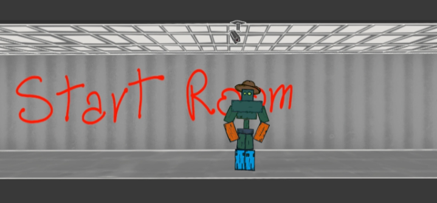

# Cowboya

Cowboya is a comedic, physics-driven 2D rogue-lite by PollegGames. You play a
small cowboy robot waking up inside a robot factory. Everything is physical:
you walk, crouch and jump, and each of your two arms independently reaches,
grabs or punches (a hand that moves fast enough becomes the attack). Robots,
cubes, junk and corpses are all objects you can push, grab, turn and throw.

The factory is run by robots working on machines. How you treat them —
switching machines off to free workers, or hitting and killing robots — moves
your **morality**, and the factory reacts: alarms, guards, blockers, and even
which rooms are generated in later levels.

> **Active branch:** `tourB` is the full rewrite and the only branch that
> describes the current game. `main` holds the first, older prototype.

## Screenshots




## Current Game (tourB)

### Run structure

```
MenuScene
  -> Level_1 -> Laboratory -> Level_2 -> Laboratory -> Level_3 -> Laboratory
  -> Level 4 -> Laboratory -> Level 5 -> Laboratory   (generated, fixed configs)
  -> Level 6+ -> Laboratory -> ...                     (generated, random, growing)
```

The itinerary lives in `RunProgressManager` as a list of `RunStepDefinition`
(`StaticLevel`, `Laboratory`, `GeneratedLevel`). See
[Run progression](Docs/Run_Progression_Static_Labo_Generated_Level_Plan.md) and
[Level 4+ progression](Docs/Level_4_Seeded_and_Later_Generated_Progression_Investigation_2026-10-09.md).

| Step | Scene | What it introduces |
|---|---|---|
| Level 1 | `Level_1` | Rooms Deads / Furnace / Garbage. The cowboy starts fainted with no energy; moving recharges it. Dead robots and junk spawn. |
| Level 2 | `Level_2` | Garage loop: a **Worker Collector** carries white cubes from the conveyor into the garage (3x3 batch of nine), then rests. The player can steal cubes. |
| Level 3 | `Level_3` | Reception desk defended by a **SecurityReception** robot, Garage without Rest room, a **Boss** carrying a badge. |
| Levels 4-5 | `MapGeneration` | Generated factory from fixed `RunMapConfigSO` assets (fixed seeds). |
| Level 6+ | `MapGeneration` | Random generation, map grows each level. |
| Between levels | `Level_Laboratory` | Physical laboratory (see below). **Next big piece to implement.** |

### Generated factory

A grid of rooms connected by doors and lifts, with a Start room and an End
room. Points of interest follow a fixed order — Resting, Reception, Security,
Spawning, Garage, Conveyor — then, from slot 7, rooms are picked by a
**morality-weighted** draw (good morality favors Security / Cube Collector /
Junks, bad morality favors Spawning / Furnace / Deads). See
[room selection](Docs/Generated_Map_Room_Selection_Design_2026-10-08.md).

### Robots

All robots share one AI pipeline: **Memory -> Brain -> Heart -> Task -> Body**
(`RobotMemoryNew`, `RobotBrainNew`, `RobotHeartNew`, `RobotTaskNew`,
`RobotBodyController`). Roles (`RobotRole`):

| Role | Behavior |
|---|---|
| Worker | Alternates between Work machines and Rest machines. When its machines are switched off it goes back to the Start room and is **saved**. |
| WorkerSpawner | Spawns workers from Spawning rooms. |
| SecurityGuard | Defends, attacks the player and goes to **switch machines back on** when the player turns them off. |
| SecurityReception | Stays anchored at the reception desk and attacks only when the player is in range. |
| Follower | **Hostile blocker.** Appears when the player has hit / killed robots (alarm raised) and comes close to the player to physically block them. |
| Boss | Defends and attacks; **faints when every machine is switched off**. Drops a badge. |
| Collector | Flying robot with a magnet: collects dead robot parts and brings them back to its machine. |
| WorkerCollector | Moves **white cubes** from the conveyor to the garage. |

### Morality

- Saving a robot raises morality, killing one lowers it.
- The alarm (`Normal`, `Wanted`, `Revolt`, `Lockdown`) reacts to violence and
  security cameras.
- Morality weights which rooms appear in generated levels, and is meant to
  influence the laboratory scientist and future upgrades.

### The cowboy and controls

The cowboy is an active ragdoll: an animated master drives a physics puppet
(`SimplePuppetBinder`), and each arm uses a 2D IK solver. Every action costs
energy. Controller-first layout (keyboard / mouse is a fallback):

| Xbox | Action |
|---|---|
| Left stick | Walk; down = crouch |
| A | Directional jump (needs a horizontal direction) |
| Right stick | Move the active hand around the body |
| LB / RB | Left / right arm grab mode |
| LT / RT | Left / right arm attack mode (fast hand = hit) |

Both arms are independent: one can hold an object while the other attacks, or
both can hold. See [Xbox two-arm controls](Docs/Xbox_Controller_Input_And_TwoArm_Control_Design.md).

**Key physical skill:** the world is 2D, so to get past a robot the player must
go physically **over or under** it, by grabbing the robot and rotating it. This
is the core movement challenge and the hardest part to test automatically —
see [robot passing replay tests](Docs/Robot_Passing_Replay_Test_Design.md).

### Laboratory (next big piece)

The laboratory is a physical room revisited between every level, not a menu:
cubes put into the `CubeCollecteur` during a level fall down a chute in the
lab; DocBot the scientist turns junk into white cubes (and reacts if you
attack or kill him); the Builder and the Upgrade Stats machine are meant to
convert cubes into Health, Energy, Recharge and Force upgrades. Cube transport
and DocBot exist; the Builder and Upgrade Stats machine are not wired yet. See
[laboratory base design](Docs/Laboratory_System_Concept_and_Implementation_Base.md).

### Current priorities

1. Make the **start of the game** (Levels 1-3 and the first lab visit) feel right.
2. Implement the **laboratory** loop.
3. Make **robot passing** (grab + rotate) reliable and measurable.
4. Long-term progression and the **save system come later** on purpose.

More: [documentation index](Docs/README.md) and the
[game vision and idea bank](Assets/ReadMe.md).

## Running Edit Mode Tests

This project uses Unity's built-in Test Framework. Edit Mode tests currently
live under `Assets/Editor/UnitTests`.

### Using the Unity Editor

1. Open the project in the Unity Editor.
2. Open **Window > General > Test Runner**.
3. Select the **Edit Mode** tab and click **Run All**.

### Using the Command Line

On Windows PowerShell:

```powershell
powershell -ExecutionPolicy Bypass -File Tools/run-editmode-tests.ps1
```

On Linux or macOS:

```bash
./Tools/run-editmode-tests.sh
```

Both scripts read the required editor version from
`ProjectSettings/ProjectVersion.txt`, write results and logs to `Logs/CI/`, and
return a non-zero exit code when tests fail. Set `UNITY_PATH` on Unix or pass
`-UnityPath` on Windows when Unity Hub is installed outside its default
location. Use a separate clone when the project is already open in Unity.

## Continuous Integration

`.github/workflows/unity-ci.yml` validates Unity metadata, runs the complete
Edit Mode suite, and creates a WebGL artifact on pushes and pull requests. It
pins Unity `6000.3.22f1`, uses the committed `Packages/packages-lock.json`, and
records the commit, editor version, and package-lock checksum in
`BUILD-PROVENANCE.txt` beside every build.

Configure the `UNITY_LICENSE` GitHub secret before enabling the workflow.
`UNITY_EMAIL` and `UNITY_PASSWORD` are also supported when required by the
license type.

### WebGL Persistent Data

Saved files in WebGL builds reside in the browser's IndexedDB storage. The
published template must explicitly enable synchronization before persistence
across browser reloads can be considered supported. (Saving is intentionally
not a priority yet — see the [audit](Docs/Audit_Ameliorations_Cowboya_2026-10-08.md)
for known save issues.)
